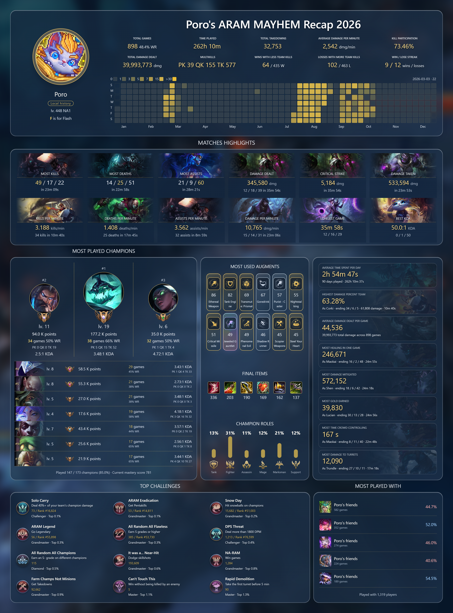

<div align="center">

# ARAM Mayhem Recap 2026

### Your year. Your mayhem. Your legend.

Every fight tells a story. Relive your ARAM Mayhem journey - from glorious victories to unforgettable chaos.

[](#quick-start)
[](#under-the-hood)
[](LICENSE)
[](README.zh-CN.md)

**English** · [简体中文](README.zh-CN.md)

[Preview](#poros-year-in-mayhem) · [Quick start](#quick-start) · [Why this exists](#why-this-exists) · [Contribute](#build-with-us)

</div>

---

## Poro's year in Mayhem



<p align="center"><em>Actual PNG export with anonymous mode enabled: Poro and Poro's friends. </em><br /><a href="docs/images/poro-recap-en.png">Full-resolution PNG</a> · <a href="README.zh-CN.md">Chinese preview</a></p>

## Why this exists

**Mayhem deserves a year in review, too.** I built this because Riot's public Match-V5 API does not expose ARAM Mayhem match data. The report about Mayhem matches returning 403 was closed as expected behavior in [RiotGames/developer-relations #1109](https://github.com/RiotGames/developer-relations/issues/1109).

I wanted to remember my own games: unexpected pentakills, the champions I kept rolling, and the friends who were there for the chaos. This project reads the signed-in player's available history through the local League Client API (LCU), saves it on the same PC, and turns it into a personal recap. No Riot API key needed.

## A year, at a glance

| The story | What you get |
| :--- | :--- |
| **Your year in Mayhem** | Games, win rate, time played, damage, multikills, streaks, and a calendar heatmap. |
| **Unforgettable games** | Twelve highlight cards with champion art and match context. |
| **Your champion podium** | Top three champions, mastery crests, and uniform #4–10 rows with games, win rate, KDA, and multikills. |
| **Your Mayhem signature** | Silver, gold, and prismatic augment icons, final items, and champion roles. |
| **Achievements & friends** | Owned ARAM challenges with available rarity, ranks, and tiers; Most Played With. |
| **A recap to keep** | Chinese and English UI, custom anonymous names, and high-resolution PNG export. |

## Quick start

**Windows x64 · Open League and sign in · Paste one command**

Press **Win + R**, type `powershell`, press Enter, then paste:

```powershell
& ([scriptblock]::Create((Invoke-WebRequest -UseBasicParsing 'https://raw.githubusercontent.com/Marc0Guo/aram-mayhem-recap-2026/main/scripts/start.ps1').Content))
```

The launcher downloads a portable runtime and locked dependencies, then opens your browser. No Git, global Node installation, or administrator rights required. Keep the terminal open; **Ctrl + C** stops the app.


<details>
<summary><strong>Already downloaded the source? Start locally</strong></summary>

Open PowerShell in the project folder:

```powershell
& ([scriptblock]::Create((Get-Content -LiteralPath .\scripts\start.ps1 -Raw))) -SourcePath (Get-Location).Path
```

Portable Node 22.20.0 and pnpm 10.18.2 install under your user profile. Node downloads use SHA-256 verification; pnpm uses registry SHA-512 integrity. The script does not change system execution policy.

</details>

<details>
<summary><strong>Just exploring? Try offline demo mode</strong></summary>

Append `-Demo` to the remote command, or run from the source folder:

```powershell
& ([scriptblock]::Create((Get-Content -LiteralPath .\scripts\start.ps1 -Raw))) -SourcePath (Get-Location).Path -Demo
```

Demo mode uses synthetic games and separate storage. No League client required.

</details>

## Make it yours

1. **Connect.** Log into League. If needed, enter the game directory containing `lockfile` in Settings and choose Save and connect.
2. **Explore.** Choose a date range and switch between English and 简体中文. Opening the app triggers a sync of available games.
3. **Share.** Enable anonymous mode and choose **Poro** or another name. Teammate IDs become **Poro's friends**. PNG export preserves the current language, filters, and anonymous labels.

## Under the hood

```text
League client → local LCU → incremental sync → SQLite → browser recap → PNG
```

| Component | Detail |
| :--- | :--- |
| **Connection** | Read-only requests to the local League client; no Riot API key. |
| **Storage** | `%LOCALAPPDATA%\AramMayhemWrapped\data\wrapped.sqlite`; demo data lives separately in `demo/`. |
| **Browser** | Loopback only, starting at `http://127.0.0.1:4173`; tries the next nine ports if busy. |
| **Updates** | Reuses the runtime, dependencies, and saved matches. No always-on collector. |
| **Display privacy** | Anonymous mode changes dashboard and PNG labels. The local database, avatars, and stats remain intact. |

<details>
<summary><strong>Connection & history questions</strong></summary>

**League directory?** Defaults to `C:\Riot Games\League of Legends`. Save custom locations in Settings.

**Missing dates?** Available history depends on what LCU returns. Imported games are preserved, but recovery of every older match is not guaranteed. Open periodically to save newly available history.

**Offline?** Previously imported games remain available offline; demo mode works without importing an account.

**Windows support?** Windows 11 x64 is the target. Windows 10 x64 still needs validation; the launcher does not currently support ARM64. A clean-VM installer acceptance run remains pending.

</details>

## Build with us

**React + TypeScript · SQLite · Vite · Windows PowerShell**

With Node 22 LTS already installed:

```powershell
corepack pnpm install --frozen-lockfile --ignore-scripts
corepack pnpm dev
```

```powershell
# Validation
corepack pnpm typecheck
corepack pnpm lint
corepack pnpm test
corepack pnpm build
node scripts/native-smoke.cjs
```

`pnpm demo` runs the offline demo. `node scripts/source-release.mjs` creates a clean source ZIP. The browser app does not require Electron; for optional Electron/e2e work, first run `node node_modules/electron/install.js`.

**Using an AI coding agent?** Start with [AGENTS.md](AGENTS.md). [CLAUDE.md](CLAUDE.md) and the [Cursor rule](.cursor/rules/project.mdc) point to the same onboarding instructions, architecture, commands, and data boundaries.

Read [Contributing](CONTRIBUTING.md), [Security](SECURITY.md), [LCU capabilities](docs/lcu-capabilities.md), and [Metric definitions](docs/metrics.md). Keep databases, League lockfiles, credentials, raw personal matches, and private screenshots out of commits.

## Inspiration & credits

The recap layout and visual presentation are inspired by **LoboBot / javilobo8's [Recap 2024](https://docs.lobobot.com/docs/recaps/recap-2024/)**, especially its overview, calendar, highlights, champion podium, and teammate sections. Thank you for the design inspiration.

Project code is licensed under [MIT](LICENSE). League artwork, icons, and metadata belong to Riot Games; their ownership is separate from the code license. Sources: [Third-party notices](THIRD_PARTY_NOTICES.md).

---

<p align="center">Built for the games that got a little out of hand.<br /><a href="https://github.com/Marc0Guo/aram-mayhem-recap-2026/issues">Report a bug or suggest an idea</a> · <a href="README.zh-CN.md">阅读中文版</a></p>
