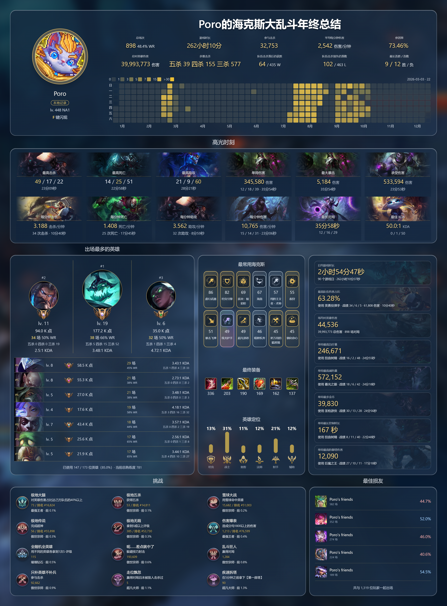

<div align="center">

# ARAM Mayhem Recap 2026

### 把这一年的海克斯大乱斗，留成一张回忆。

你是否也曾羡慕国服玩家有 WeGame 年终总结，而自己在美服打了一整年海克斯大乱斗，连个年度报告都没有？😭

没关系，Riot 不做，我们自己做！

不需要 Riot API Key，不需要上传战绩。打开英雄联盟客户端，一行命令启动。

是五杀战神，还是移动提款机？是发牌员的天选之子，还是队友眼里的头号战犯？

今年的海斗，你的数据会说话。

[](#一行启动)
[](#数据如何流动)
[](LICENSE)
[](README.md)

[English](README.md) · **简体中文**

[效果预览](#看看-poro-的这一年) · [一行启动](#一行启动) · [项目缘起](#为什么做这个项目) · [参与开发](#一起完善这个项目)

</div>

---

## 看看 Poro 的这一年



<p align="center"><em>实际导出的 PNG，已开启匿名模式。自己显示为 Poro，好友显示为 Poro's friends。</em><br /><a href="docs/images/poro-recap-zh-CN.png">查看原尺寸 PNG</a> · <a href="README.md">查看英文版本</a></p>

## 为什么做这个项目

**美服玩家，也值得拥有一份年终总结！**

Riot 的公开 Match-V5 API 不开放 ARAM Mayhem 的对局数据。关于 Mayhem 对局返回 403 的问题，已在 [RiotGames/developer-relations #1109](https://github.com/RiotGames/developer-relations/issues/1109) 中被关闭并标记为预期行为。

既然公开 API 不给数据，那就换条路。通过本地英雄联盟客户端 API（LCU）读取当前登录账号可获得的历史对局。

## 🏆 来看看你的年度海斗罪证

| 年终总结项目 | 公开处刑内容 |
| :--- | :--- |
| 📊 **年度坐牢报告** | 总场次、胜率、游戏时长、总伤害、连胜连败。看看你今年为嚎哭深渊贡献了多少青春 |
| 🔥 **年度名场面** | 12 张高光卡片。那些你以为没人记得的五杀，数据库替你记着 |
| 👑 **英雄排行榜** | 最爱玩的英雄 TOP 10、场次、胜率、KDA、五杀／四杀／三杀。绝活哥还是英雄币，一眼鉴定 |
| 🎲 **海克斯赌狗档案** | 银色、金色、棱彩强化分布、最终出装、英雄定位。看看你有多爱追求梦想 |
| 🏅 **年度成就展示** | 极地挑战、稀有度、排名和段位。该炫耀的东西一个都不能少 |
| 🤝 **最佳坐牢搭子** | 谁陪你打的最多？谁和你一起见证了最多离谱对局？ |
| 🖼️ **年度赛博奖状** | 中英双语、匿名昵称、高清 PNG 导出。可以发给朋友，也可以发小红书公开处刑自己 |


## 一行启动

**Windows x64 · 打开英雄联盟并登录 · 粘贴一行命令**

按 **Win + R**，输入 `powershell` 并回车，然后粘贴：

```powershell
& ([scriptblock]::Create((Invoke-WebRequest -UseBasicParsing 'https://raw.githubusercontent.com/Marc0Guo/aram-mayhem-recap-2026/main/scripts/start.ps1').Content))
```

启动器会下载便携运行环境与锁定版本的依赖，然后自动打开浏览器。无须预装 Git 或 Node，也无须管理员权限。使用期间保留终端，按 **Ctrl + C** 停止。


<details>
<summary><strong>已经下载源码？在本地启动</strong></summary>

在项目目录打开 PowerShell：

```powershell
& ([scriptblock]::Create((Get-Content -LiteralPath .\scripts\start.ps1 -Raw))) -SourcePath (Get-Location).Path
```

脚本将便携版 Node 22.20.0 与 pnpm 10.18.2 安装到当前用户目录。Node 按 SHA-256 清单校验，pnpm 按 npm 注册表的 SHA-512 完整性值校验，不修改系统执行策略。

</details>

<details>
<summary><strong>先看看效果？试试离线演示</strong></summary>

在远程命令末尾加上 `-Demo`，或在源码目录执行：

```powershell
& ([scriptblock]::Create((Get-Content -LiteralPath .\scripts\start.ps1 -Raw))) -SourcePath (Get-Location).Path -Demo
```

演示模式使用模拟对局与独立存储，不需要启动英雄联盟。

</details>

## 生成你的专属回顾

1. **连接客户端。** 登录英雄联盟；如安装位置不同，在设置中填写包含 `lockfile` 的游戏目录，保存后自动连接并导入。
2. **回顾这一年。** 选择日期范围，切换简体中文或 English。打开仪表盘时会同步可获得的对局。
3. **保存与分享。** 开启匿名模式，输入 **Poro** 等昵称。好友 ID 显示为 **Poro's friends**。导出的 PNG 保留当前语言、筛选和匿名状态。

## 数据如何流动

```text
英雄联盟客户端 → 本地 LCU → 增量同步 → SQLite → 浏览器仪表盘 → PNG
```

| 环节 | 实现方式 |
| :--- | :--- |
| **读取** | 对本地英雄联盟客户端发起只读请求，不需要 Riot API Key。 |
| **存储** | `%LOCALAPPDATA%\AramMayhemWrapped\data\wrapped.sqlite`；演示数据单独保存在 `demo/`。 |
| **访问** | 仅监听本机，默认 `http://127.0.0.1:4173`，被占用时尝试之后 9 个端口。 |
| **更新** | 复用运行环境、依赖与已保存对局，无须常驻采集。 |
| **匿名** | 修改页面与 PNG 的显示昵称，保留本地数据库、头像和统计。 |

<details>
<summary><strong>连接与历史数据常见问题</strong></summary>

**游戏目录怎么填？** 默认是 `C:\Riot Games\League of Legends`，自定义安装位置可以在设置中保存。

**为什么有些日期没有数据？** 可获得的历史取决于 LCU 实际返回的内容。项目会保留已经导入的对局，但无法保证找回所有旧记录；定期打开可保存新出现的对局。

**能离线看吗？** 已导入的内容可以离线浏览；没有账号数据也能使用独立演示模式。

**支持哪些 Windows？** 目标是 Windows 11 x64。Windows 10 x64 尚待验证，启动器目前不支持 ARM64；完整的干净虚拟机安装验收仍待完成。

</details>

## 一起完善这个项目

**React + TypeScript · SQLite · Vite · Windows PowerShell**

如果已经安装 Node 22 LTS：

```powershell
corepack pnpm install --frozen-lockfile --ignore-scripts
corepack pnpm dev
```

```powershell
# 验证
corepack pnpm typecheck
corepack pnpm lint
corepack pnpm test
corepack pnpm build
node scripts/native-smoke.cjs
```

`pnpm demo` 启动离线演示，`node scripts/source-release.mjs` 生成干净源码 ZIP。浏览器版本不需要 Electron；可选的 Electron／e2e 开发需先执行 `node node_modules/electron/install.js`。

**用 AI Agent 开发？** 从 [AGENTS.md](AGENTS.md) 开始。[CLAUDE.md](CLAUDE.md) 与 [Cursor 规则](.cursor/rules/project.mdc) 指向相同的入门说明、架构、运行命令和数据边界。

欢迎阅读[贡献指南](CONTRIBUTING.md)、[安全说明](SECURITY.md)、[LCU 能力记录](docs/lcu-capabilities.md)与[指标定义](docs/metrics.md)。提交时请勿包含数据库、League lockfile、凭据、个人原始对局和私人截图。

## 设计灵感与致谢

本项目的回顾布局与视觉呈现借鉴了 **LoboBot / javilobo8 的 [Recap 2024](https://docs.lobobot.com/docs/recaps/recap-2024/)**，尤其是总览、日历、高光、英雄领奖台与队友板块。感谢原作者带来的设计启发。

项目代码采用 [MIT 许可](LICENSE)。英雄联盟原画、图标与元数据属于 Riot Games，其所有权独立于代码许可；素材来源见[第三方素材说明](THIRD_PARTY_NOTICES.md)。

---

<p align="center">留住那些打得有点上头的对局。<br /><a href="https://github.com/Marc0Guo/aram-mayhem-recap-2026/issues">反馈问题或提出想法</a> · <a href="README.md">Read in English</a></p>
